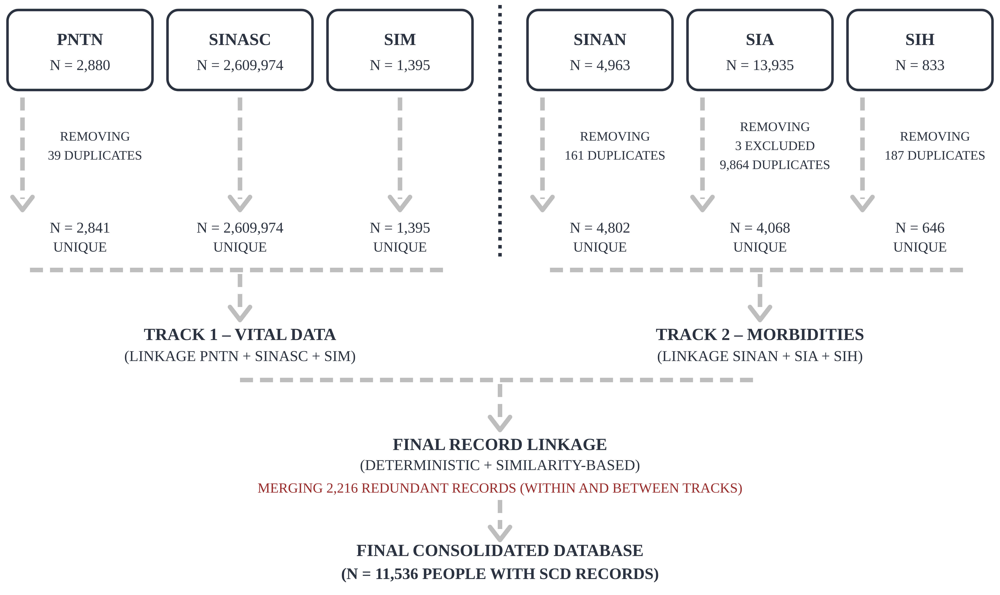

# Sickle cell disease data qualification protocol

🌐 **English** · [Português](#português)

Alteryx workflows and R code for the record-linkage protocol that integrates six Brazilian health information systems (SINASC, PNTN, SIM, SINAN, SIA, SIH) to produce qualified incidence, prevalence and mortality indicators of sickle cell disease — Bahia, Brazil, 2010–2022.

| Folder | Content |
|---|---|
| `workflows/` | `Track1_VitalData.yxmd`, `Track2_Morbidity.yxmd`, `FinalLinkage.yxmd` (Alteryx Designer 2024.2) |
| `R/` | `ahp_underreporting.R` — AHP underreporting correction factor (base R) |
| `images/` | Article figures and Alteryx workflow screenshots |
| `docs/` | Full documentation (archived with each release) |
| `wiki/` | Wiki source — published automatically to the repository Wiki |
| `data/`, `output/` | Empty — input data are **not** distributed |

📖 **Documentation:** see the [Wiki](https://github.com/05071982/DF-linkage-protocol-Metodologico/wiki) or [`docs/Home.md`](docs/Home.md).

**Data protection.** No individual-level data are included. Inputs must be requested from the data custodians under ethics approval.

**Licence:** code MIT · documentation CC BY 4.0. **Citation:** see `CITATION.cff` · DOI [10.5281/zenodo.23993752](https://doi.org/10.5281/zenodo.23993752).

---

## Português

Fluxos do Alteryx e código em R do protocolo de linkage que integra seis sistemas de informação em saúde (SINASC, PNTN, SIM, SINAN, SIA, SIH) para produzir indicadores qualificados de incidência, prevalência e mortalidade por doença falciforme — Bahia, 2010–2022.

📖 **Documentação:** ver a [Wiki](https://github.com/05071982/DF-linkage-protocol-Metodologico/wiki) ou [`docs/Inicio.md`](docs/Inicio.md).

**Proteção de dados.** Nenhum dado individual está incluído. Os dados de entrada devem ser solicitados aos detentores, com aprovação ética.
