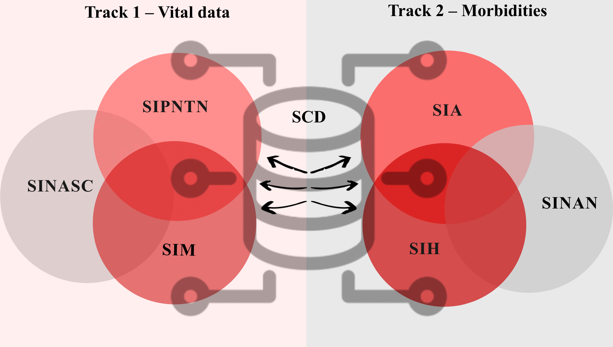
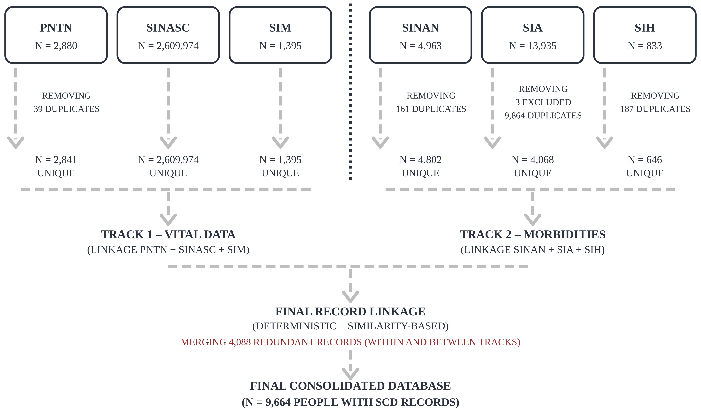
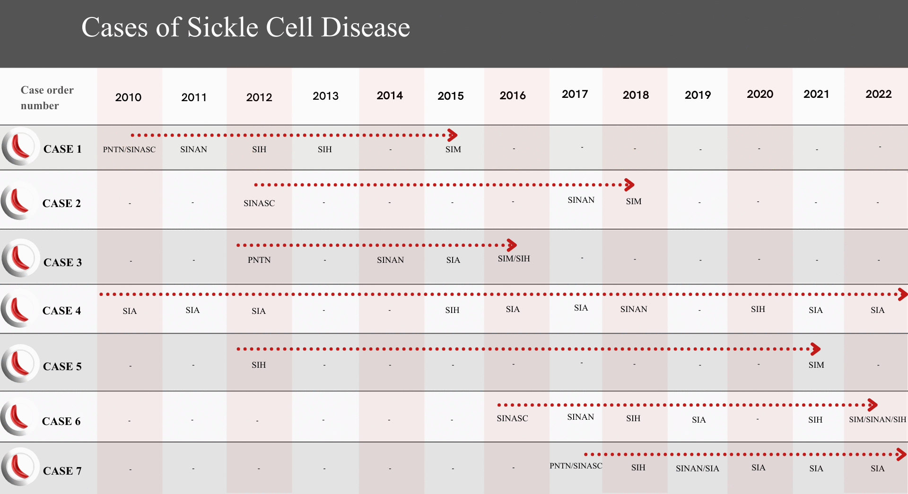

🌐 **English** · [Português](1-Visao-Geral.md)

# 1. Overview and architecture

The protocol reconstructs the trajectory of each person with SCD — from birth and neonatal screening to notification, outpatient care, hospitalisation and death — by integrating six information systems in **two analytical tracks** and one **final linkage**.



| Track | Systems | Role |
|---|---|---|
| **Track 1 — Vital data** | PNTN, SINASC, SIM | Births with SCD (screening), live-birth reference and deaths |
| **Track 2 — Morbidity** | SINAN, SIA, SIH | Notifications, outpatient procedures and hospital admissions |
| **Final linkage** | Track 1 × Track 2 | One record per person; basis for incidence, prevalence and mortality |

## Pipeline

```
Raw HIS extracts
   └─► Standardisation (text, dates, municipality codes)
         └─► Composite keys
               └─► Within-source deduplication
                     └─► Track 1 linkage  ┐
                     └─► Track 2 linkage  ┴─► Final linkage ─► Sequential deduplication
                                                                 └─► Clerical validation
                                                                       └─► Consolidated base (N = 9,664)
                                                                             └─► Indicators + AHP correction
```

## Record flow



## Case trajectories (illustrative, fictitious cases)

Each row is one person; each cell shows the system in which the person was recorded that year. Linkage joins these scattered records into one trajectory.



## Linkage status codes

Every record leaves the tracks with a status code that tells in which systems it was found.
| Code | Track 1 | Code | Track 2 |
|---|---|---|---|
| 1 | PNTN + SINASC + SIM | 8 | SINAN + SIA + SIH |
| 2 | SINASC + SIM | 9 | SIA + SIH |
| 3 | PNTN + SIM | 10 | SINAN + SIH |
| 4 | PNTN + SINASC | 11 | SINAN + SIA |
| 5 | SINASC only (birth without SCD record) | 12 | SIA only |
| 6 | PNTN only | 13 | SINAN only |
| 7 | SIM only | 14 | SIH only |
