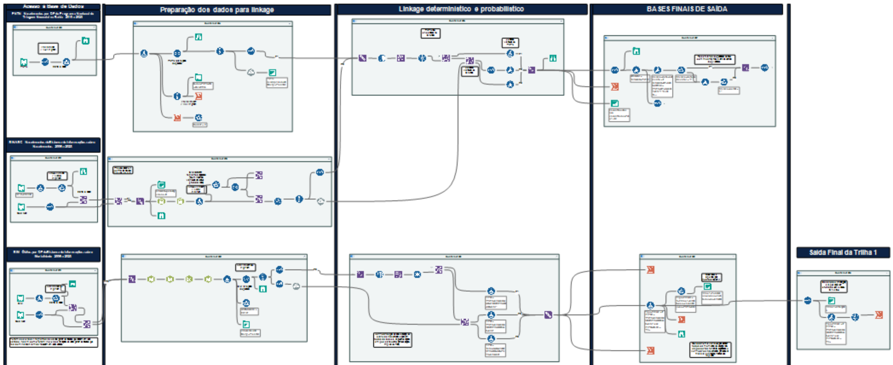

🌐 **English** · [Português](5-Trilha-1-Dados-Vitais.md)

# 5. Track 1 — Vital data (PNTN · SINASC · SIM)

Workflow: [`workflows/Track1_VitalData.yxmd`](../workflows/Track1_VitalData.yxmd)

## Steps

1. **Input and filters** — PNTN positive results, SINASC live births and SIM SCD deaths (declared + presumed), 2010–2022. SIM: residents of Bahia who died in other states are included; non-residents are excluded.
2. **Standardisation and keys** — see [Data preparation](4-Data-Preparation.md).
3. **Within-source deduplication**
   - *PNTN*: exact duplicates on the key removed (39); siblings of the same mother kept, since no twin indicator is available.
   - *SINASC*: multiple births (`GRAVIDEZ` = 2 or 3) and siblings kept; residual duplicates are removed only **after** linkage, so that true pairs are not lost.
   - *SIM*: death certificate number + key (no duplicates found).
4. **Linkage A — PNTN × SINASC** (Fuzzy Match, merge mode, threshold ≥ 85%). Consistency flags: same date of birth; same neighbourhood.
5. **Linkage B — (PNTN ∪ SINASC) × SIM** (same settings).
6. **Status codes 1–7** assigned (see [Overview](1-Overview.md#linkage-status-codes)).
7. **Output** — status 5 (SINASC-only births, i.e. births without any SCD record) is set aside; the remaining records go to the [final linkage](7-Final-Linkage.md).

## Fuzzy Match settings

| Parameter | Value |
|---|---|
| Mode | Merge (compares records from different sources only) |
| Match field | Composite key |
| Key generation | Double Metaphone, max length 4 |
| Similarity function | Jaro–TF-IDF (additional: no-space) |
| Threshold (record / field) | 85% / 85% |
| Output | Pairs with match score; one pair kept per record ID combination |

## Alteryx canvas

