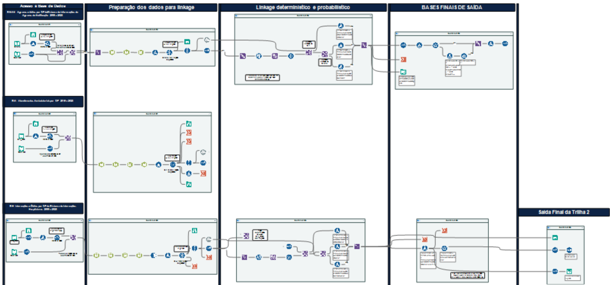

🌐 [English](6-Track-2-Morbidity.md) · **Português**

# 6. Trilha 2 — Morbidade (SINAN · SIA · SIH)

Fluxo: [`workflows/Track2_Morbidity.yxmd`](../workflows/Track2_Morbidity.yxmd)

## Etapas

1. **Entrada e filtros** — notificações do SINAN (residentes na Bahia), procedimentos do SIA e internações do SIH (Salvador), 2010–2022.
2. **Padronização e chaves** — chave com nome do paciente nos três sistemas; chave com nome da mãe no SINAN e no SIH; chave com os últimos 10 caracteres no SIA.
3. **Desduplicação em cada fonte** — um registro por pessoa. A repetição é esperada: o acompanhamento mensal de hemoglobinopatias e o Doppler transcraniano explicam a maior parte das duplicidades do SIA (9.864, após a exclusão de 3 registros com código de município inválido ou fora do período); as reinternações explicam as do SIH (187; o fluxo mostra 188 porque o cruzamento com a tabela de municípios gerou uma cópia de um registro); as notificações repetidas, as do SINAN (161).
4. **Linkage A — SINAN × SIA** (Fuzzy Match, modo merge, **limiar do registro ≥ 90%**, limiar do campo ≥ 85%). Sinalizadores de consistência: mesma data de nascimento; mesmo bairro.
5. **Linkage B — (SINAN ∪ SIA) × SIH** (mesmos parâmetros) mais uma etapa determinística com chave exata.
6. **Códigos de status 8–14** atribuídos.
7. **Saída** enviada ao [linkage final](7-Linkage-Final.md).

> Na Trilha 2 usou-se um limiar mais rigoroso (90%) porque o nome é o único identificador forte no SIA, que não tem o nome da mãe.

## Canvas do Alteryx

