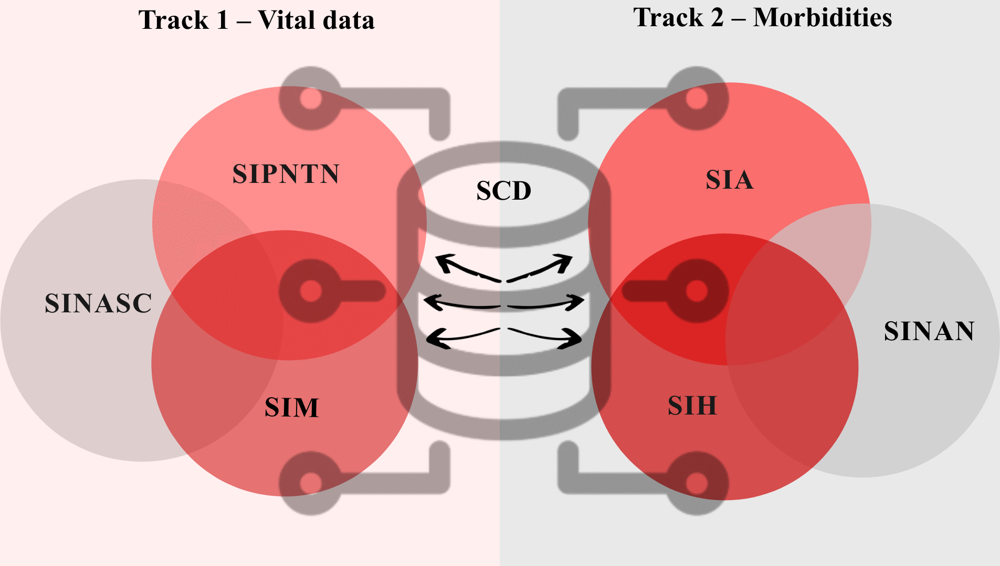

🌐 **English** · [Português](Inicio.md)

# Data qualification protocol for sickle cell disease indicators

**Record linkage of six Brazilian health information systems to estimate the incidence, prevalence and mortality of sickle cell disease (SCD) — Bahia, Brazil, 2010–2022.**

This wiki documents, step by step, the methodological protocol described in the article:

> Leal JTFM, Nery JS, Pereira JCL, Mota ELA, Britto CCRF, Andrade JR, Natividade MS, Carvalho-Sauer RCO, Ramos DO, Mota CS. *Methodologies for the qualification of data applied to the production of epidemiological indicators of sickle cell disease.* (manuscript under review)

## Why this protocol?

Brazil has no single patient identifier across its health information systems (HIS). People with SCD therefore appear several times — or not at all — in births, screening, notification, outpatient, hospital and mortality records. This fragmentation leads to underreporting and keeps the disease invisible to public health planning.

The protocol combines **deterministic and probabilistic record linkage**, **deduplication**, **clerical validation** and an **AHP-based underreporting correction** to build one record per person and produce qualified indicators.

## At a glance

| | |
|---|---|
| Information systems | SINASC, PNTN, SIM, SINAN, SIA, SIH |
| Period | 2010–2022 |
| Linkage tool | Alteryx Designer (Fuzzy Match, Double Metaphone, Jaro–TF-IDF) |
| Final consolidated base | **11,536 people with SCD** |
| Positive predictive value of linked pairs | **92.4%** (95% CI 91.1–93.5; 1,806 pairs reviewed) |
| Underreporting correction factor (AHP) | **F = 0.3923** (CR = 0.015) |

## Contents

1. [Overview and architecture](1-Overview.md)
2. [Data sources](2-Data-Sources.md)
3. [Case definitions](3-Case-Definitions.md)
4. [Data preparation](4-Data-Preparation.md)
5. [Track 1 — Vital data](5-Track-1-Vital-Data.md)
6. [Track 2 — Morbidity](6-Track-2-Morbidity.md)
7. [Final linkage](7-Final-Linkage.md)
8. [Validation](8-Validation.md)
9. [Underreporting correction (AHP)](9-Underreporting-Correction-AHP.md)
10. [How to use](10-How-to-Use.md)
11. [Tools and licences](11-Tools-and-Licences.md)
12. [Team](12-Team.md)
13. [References and how to cite](13-References-and-Citation.md)

> **Data protection.** No individual-level data are published in this repository. The workflows contain only processing logic; input files must be obtained from the data custodians under ethics approval (see [How to use](10-How-to-Use.md)).
