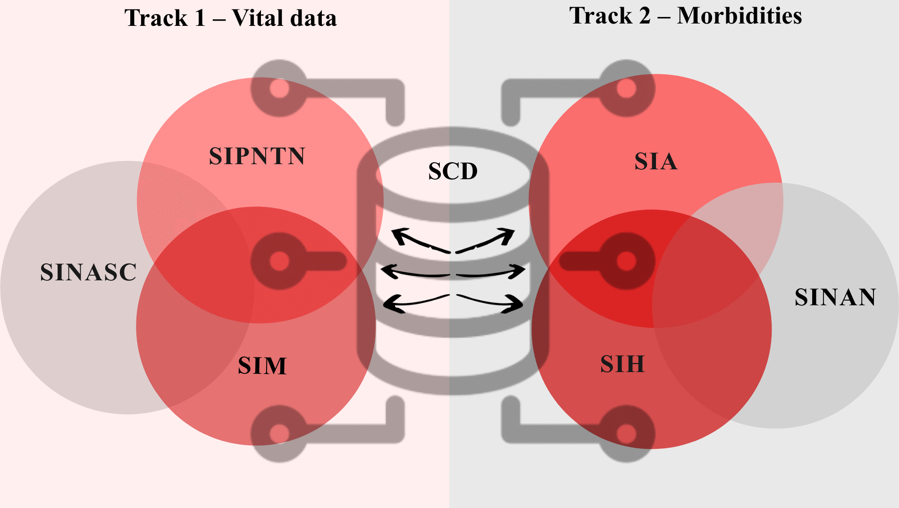
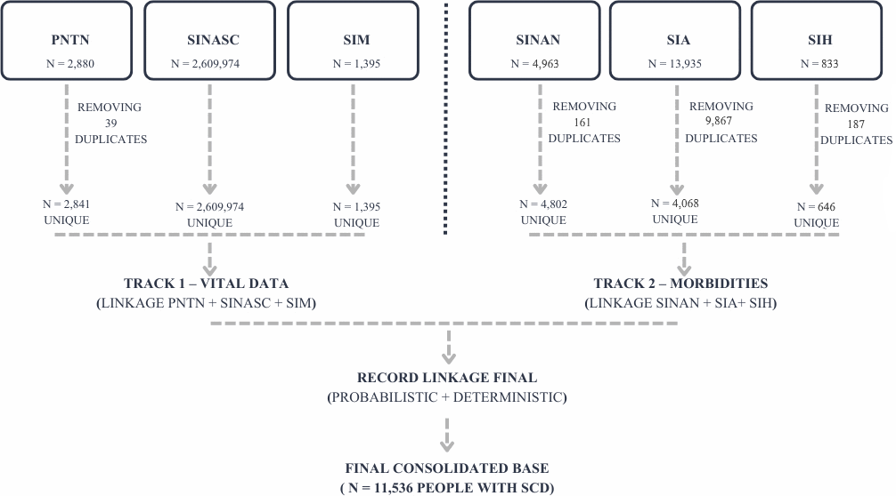
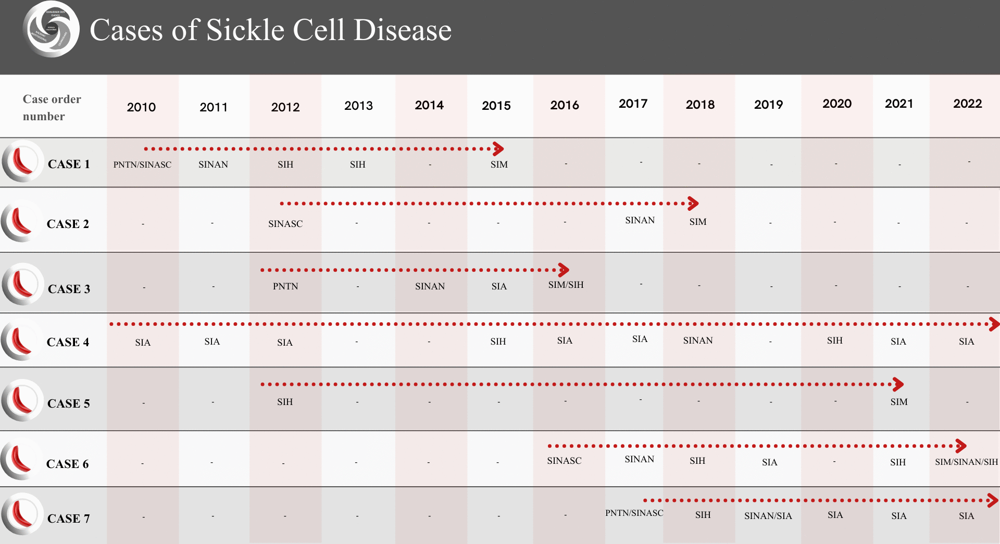

🌐 [English](1-Overview) · **Português**

# 1. Visão geral e arquitetura

O protocolo reconstrói a trajetória de cada pessoa com DF — do nascimento e da triagem neonatal à notificação, ao atendimento ambulatorial, à internação e ao óbito — integrando seis sistemas em **duas trilhas analíticas** e um **linkage final**.



| Trilha | Sistemas | Papel |
|---|---|---|
| **Trilha 1 — Dados vitais** | PNTN, SINASC, SIM | Nascidos com DF (triagem), referência de nascidos vivos e óbitos |
| **Trilha 2 — Morbidade** | SINAN, SIA, SIH | Notificações, procedimentos ambulatoriais e internações |
| **Linkage final** | Trilha 1 × Trilha 2 | Um registro por pessoa; base para incidência, prevalência e mortalidade |

## Fluxo de processamento

```
Extrações brutas dos SIS
   └─► Padronização (texto, datas, códigos de município)
         └─► Chaves compostas
               └─► Desduplicação em cada fonte
                     └─► Linkage da Trilha 1 ┐
                     └─► Linkage da Trilha 2 ┴─► Linkage final ─► Desduplicação sequencial
                                                                 └─► Validação manual
                                                                       └─► Base consolidada (N = 11.536)
                                                                             └─► Indicadores + correção AHP
```

## Fluxo de registros



## Trajetórias de casos (ilustrativas, casos fictícios)

Cada linha é uma pessoa; cada célula mostra o sistema em que ela foi registrada naquele ano. O linkage une esses registros dispersos em uma única trajetória.



## Códigos de status do linkage

Cada registro sai das trilhas com um código que indica em quais sistemas foi encontrado.

| Código | Trilha 1 | Código | Trilha 2 |
|---|---|---|---|
| 1 | PNTN + SINASC + SIM | 8 | SINAN + SIA + SIH |
| 2 | SINASC + SIM | 9 | SIA + SIH |
| 3 | PNTN + SIM | 10 | SINAN + SIH |
| 4 | PNTN + SINASC | 11 | SINAN + SIA |
| 5 | Só SINASC (nascido sem registro de DF) | 12 | Só SIA |
| 6 | Só PNTN | 13 | Só SINAN |
| 7 | Só SIM | 14 | Só SIH |
