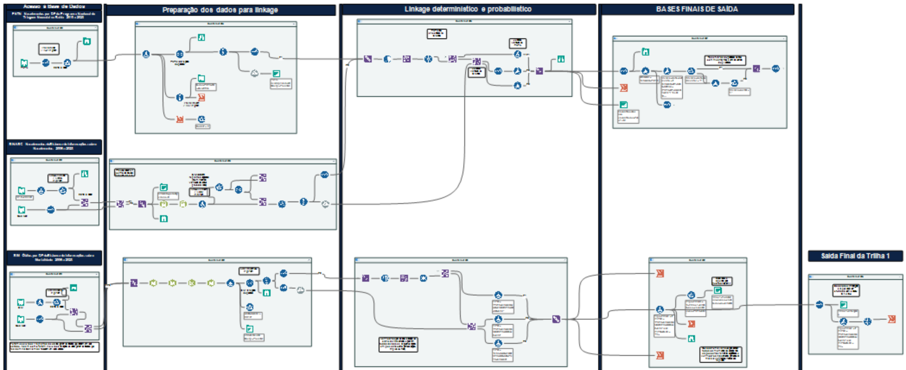

🌐 [English](5-Track-1-Vital-Data) · **Português**

# 5. Trilha 1 — Dados vitais (PNTN · SINASC · SIM)

Fluxo: [`workflows/Track1_VitalData.yxmd`](../blob/main/workflows/Track1_VitalData.yxmd)

## Etapas

1. **Entrada e filtros** — resultados positivos do PNTN, nascidos vivos do SINASC e óbitos por DF do SIM (declarados + presumidos), 2010–2022. No SIM, residentes na Bahia que faleceram em outros estados são incluídos e não residentes, excluídos.
2. **Padronização e chaves** — ver [Preparação dos dados](4-Preparacao-dos-Dados).
3. **Desduplicação em cada fonte**
   - *PNTN*: duplicidades exatas na chave removidas (39); irmãos da mesma mãe mantidos, já que não há indicador de gemelaridade.
   - *SINASC*: partos múltiplos (`GRAVIDEZ` = 2 ou 3) e irmãos mantidos; duplicidades residuais removidas só **depois** do linkage, para não perder pares verdadeiros.
   - *SIM*: número da DO + chave (nenhuma duplicidade encontrada).
4. **Linkage A — PNTN × SINASC** (Fuzzy Match, modo merge, limiar ≥ 85%). Sinalizadores de consistência: mesma data de nascimento; mesmo bairro.
5. **Linkage B — (PNTN ∪ SINASC) × SIM** (mesmos parâmetros).
6. **Códigos de status 1–7** atribuídos (ver [Visão geral](1-Visao-Geral#códigos-de-status-do-linkage)).
7. **Saída** — o status 5 (nascidos só no SINASC, isto é, sem nenhum registro de DF) é separado; os demais seguem para o [linkage final](7-Linkage-Final).

## Parâmetros do Fuzzy Match

| Parâmetro | Valor |
|---|---|
| Modo | Merge (compara apenas registros de fontes diferentes) |
| Campo de pareamento | Chave composta |
| Geração de chave | Double Metaphone, até 4 caracteres |
| Função de similaridade | Jaro–TF-IDF (adicional: sem espaços) |
| Limiar (registro / campo) | 85% / 85% |
| Saída | Pares com escore; um par mantido por combinação de IDs |

## Canvas do Alteryx

