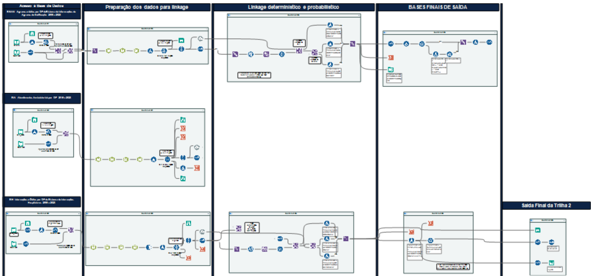

🌐 **English** · [Português](6-Trilha-2-Morbidade)

# 6. Track 2 — Morbidity (SINAN · SIA · SIH)

Workflow: [`workflows/Track2_Morbidity.yxmd`](../blob/main/workflows/Track2_Morbidity.yxmd)

## Steps

1. **Input and filters** — SINAN notifications (Bahia residents), SIA outpatient procedures and SIH admissions (Salvador), 2010–2022.
2. **Standardisation and keys** — patient's-name key for all three systems; mother's-name key for SINAN and SIH; last-10-characters key for SIA.
3. **Within-source deduplication** — one record per person. Repetition is expected: monthly follow-up of haemoglobinopathies and transcranial Doppler explain most SIA duplicates (9,864, after 3 records with invalid municipality code or outside the period were excluded); readmissions explain SIH duplicates (187; the workflow shows 188 because the join with the municipality table created one copy of a record); repeated notifications explain SINAN duplicates (161).
4. **Linkage A — SINAN × SIA** (Fuzzy Match, merge mode, **record threshold ≥ 90%**, field threshold ≥ 85%). Consistency flags: same date of birth; same neighbourhood.
5. **Linkage B — (SINAN ∪ SIA) × SIH** (same settings) plus an exact-key deterministic pass.
6. **Status codes 8–14** assigned.
7. **Output** sent to the [final linkage](7-Final-Linkage).

> A stricter record threshold (90%) was used in Track 2 because names are the only strong identifier in SIA, which has no mother's name.

## Alteryx canvas

