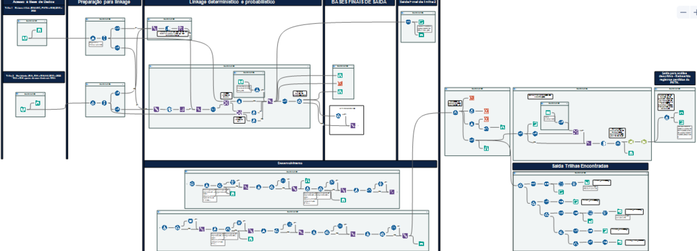

🌐 **English** · [Português](7-Linkage-Final)

# 7. Final linkage — Track 1 × Track 2

Workflow: [`workflows/FinalLinkage.yxmd`](../blob/main/workflows/FinalLinkage.yxmd)

## Steps

1. **Inputs** — Track 1 base (status 1–7, except 5) and Track 2 base (status 8–14).
2. **Deterministic linkage** — exact match on the composite key; matched pairs are loaded first.
3. **Probabilistic linkage** — Fuzzy Match ≥ 85%, run with two key variants (mother's-name key and child's-name key) to recover pairs missed by either variant.
4. **Classification** — found in both tracks / Track 1 only / Track 2 only. Agreement of the date of birth between tracks is flagged (`Mesma_data_Nasc`) to support clerical review.
5. **Sequential deduplication** — unique records across all key variants. PNTN records are re-instated after deduplication, so no screened birth is lost.
6. **Clerical validation** — see [Validation](8-Validation).
7. **Output** — consolidated base of **11,536 people with SCD**.

## From 13,752 records to 11,536 people

| | n |
|---|---|
| Sum of unique records per system (excluding SINASC) | 13,752 |
| Overlap between tracks removed by linkage | − 2,216 |
| **Final consolidated base** | **11,536** |

## Alteryx canvas

