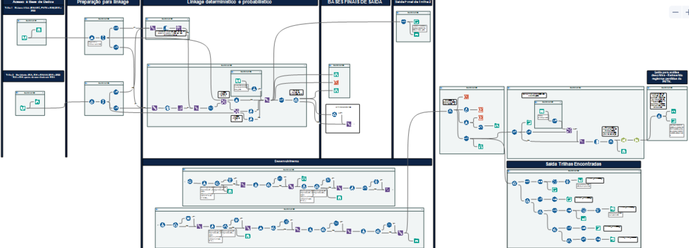

🌐 [English](7-Final-Linkage) · **Português**

# 7. Linkage final — Trilha 1 × Trilha 2

Fluxo: [`workflows/FinalLinkage.yxmd`](../blob/main/workflows/FinalLinkage.yxmd)

## Etapas

1. **Entradas** — base da Trilha 1 (status 1–7, exceto 5) e base da Trilha 2 (status 8–14).
2. **Linkage determinístico** — pareamento exato na chave composta; os pares encontrados entram primeiro.
3. **Linkage por similaridade** — Fuzzy Match ≥ 85%, rodado com duas variantes de chave (nome da mãe e nome da criança) para recuperar pares que uma das variantes perderia.
4. **Classificação** — encontrado nas duas trilhas / só na Trilha 1 / só na Trilha 2. A concordância da data de nascimento entre as trilhas é sinalizada (`Mesma_data_Nasc`) para apoiar a revisão manual.
5. **Desduplicação sequencial** — registros únicos em todas as variantes de chave. Os registros do PNTN são reinseridos após a desduplicação, para que nenhum nascido triado se perca.
6. **Validação manual** — ver [Validação](8-Validacao).
7. **Saída** — base consolidada com **9.664 pessoas com registro de DF**.

## De 13.752 registros a 9.664 pessoas

| | n |
|---|---|
| Soma dos registros únicos por sistema (exceto SINASC) | 13.752 |
| Registros redundantes unidos pelo linkage (dentro e entre as trilhas) | − 4.088 |
| **Base final consolidada** | **9.664** |
| das quais: óbitos no período (SIM) | 1.395 |
| das quais: sem registro de óbito | 8.269 |

Essas são **contagens observadas**. As estimativas de incidência e prevalência são obtidas depois (correção pelo AHP seguida de estimação bayesiana com prioris de estudos anteriores) e são relatadas nos artigos de desfecho.

## Canvas do Alteryx

