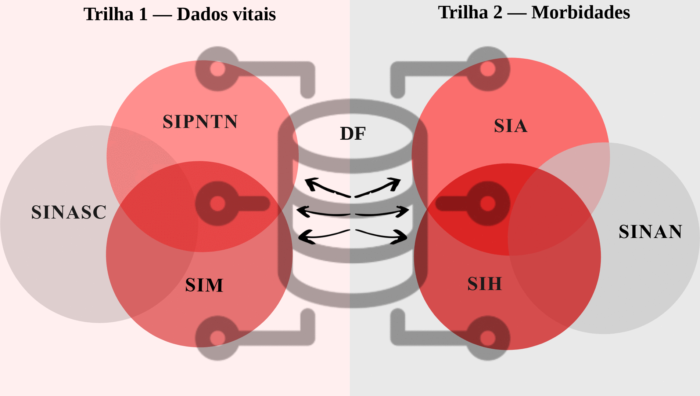

🌐 [English](Home) · **Português**

# Protocolo de qualificação de dados para indicadores de doença falciforme

**Linkage de seis sistemas de informação em saúde brasileiros para estimar incidência, prevalência e mortalidade por doença falciforme (DF) — Bahia, 2010–2022.**

Esta wiki documenta, passo a passo, o protocolo metodológico descrito no artigo:

> Leal JTFM, Nery JS, Pereira JCL, Mota ELA, Britto CCRF, Andrade JR, Natividade MS, Carvalho-Sauer RCO, Ramos DO, Mota CS. *Methodologies for the qualification of data applied to the production of epidemiological indicators of sickle cell disease.* (manuscrito em avaliação)

## Por que este protocolo?

O Brasil não tem um identificador único do paciente entre os sistemas de informação em saúde (SIS). Pessoas com DF aparecem várias vezes — ou nenhuma — nos registros de nascimento, triagem, notificação, atendimento ambulatorial, internação e óbito. Essa fragmentação gera subnotificação e mantém a doença invisível para o planejamento em saúde.

O protocolo combina **linkage determinístico e probabilístico**, **desduplicação**, **validação manual** e **correção da subnotificação pelo AHP** para chegar a um registro por pessoa e produzir indicadores qualificados.

## Resumo

| | |
|---|---|
| Sistemas | SINASC, PNTN, SIM, SINAN, SIA, SIH |
| Período | 2010–2022 |
| Ferramenta de linkage | Alteryx Designer (Fuzzy Match, Double Metaphone, Jaro–TF-IDF) |
| Base final consolidada | **11.536 pessoas com DF** |
| Valor preditivo positivo dos pares | **92,4%** (IC95% 91,1–93,5; 1.806 pares revisados) |
| Fator de correção da subnotificação (AHP) | **F = 0,3923** (RC = 0,015) |

## Conteúdo

1. [Visão geral e arquitetura](1-Visao-Geral)
2. [Fontes de dados](2-Fontes-de-Dados)
3. [Definições de caso](3-Definicoes-de-Caso)
4. [Preparação dos dados](4-Preparacao-dos-Dados)
5. [Trilha 1 — Dados vitais](5-Trilha-1-Dados-Vitais)
6. [Trilha 2 — Morbidade](6-Trilha-2-Morbidade)
7. [Linkage final](7-Linkage-Final)
8. [Validação](8-Validacao)
9. [Correção da subnotificação (AHP)](9-Correcao-da-Subnotificacao-AHP)
10. [Como usar](10-Como-Usar)
11. [Ferramentas e licenças](11-Ferramentas-e-Licencas)
12. [Equipe](12-Equipe)
13. [Referências e como citar](13-Referencias-e-Citacao)

> **Proteção de dados.** Nenhum dado individual é publicado neste repositório. Os fluxos contêm apenas a lógica de processamento; os arquivos de entrada devem ser solicitados aos detentores dos dados, com aprovação ética (ver [Como usar](10-Como-Usar)).
